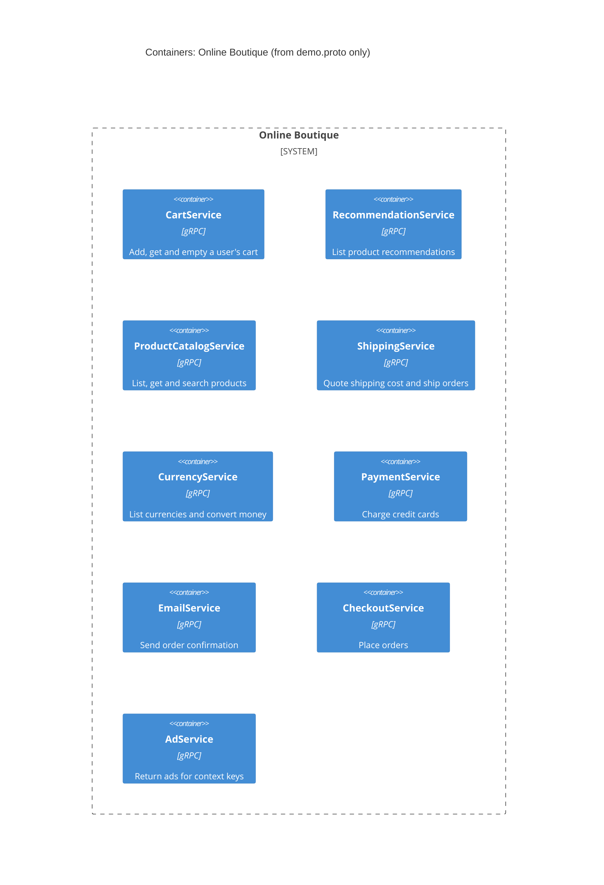

# Task 1 - Run A: Recovered architecture (evidence: demo.proto only)

## 1. Agent

Claude Sonnet 5.5 (claude-sonnet-5-5) via Claude Code subagent

## 2. Files read

- `AGENTS.md`
- `prompts/1-recover-architecture.md`
- `system/online-boutique/protos/demo.proto`

## 3. Containers table

All containers below are gRPC services declared in the proto file (package `hipstershop`). The file does not state their implementation language, so technology is "Not evidenced" apart from gRPC/protobuf.

| Container | Technology / language | Responsibility | Evidence |
|---|---|---|---|
| CartService | gRPC (proto3); language not evidenced | Add item to, get, and empty a user's cart (`AddItem`, `GetCart`, `EmptyCart`) | `system/online-boutique/protos/demo.proto` (`service CartService`) |
| RecommendationService | gRPC (proto3); language not evidenced | List recommended product IDs (`ListRecommendations`) | `system/online-boutique/protos/demo.proto` (`service RecommendationService`) |
| ProductCatalogService | gRPC (proto3); language not evidenced | List, get and search products (`ListProducts`, `GetProduct`, `SearchProducts`) | `system/online-boutique/protos/demo.proto` (`service ProductCatalogService`) |
| ShippingService | gRPC (proto3); language not evidenced | Quote shipping cost and ship an order (`GetQuote`, `ShipOrder`) | `system/online-boutique/protos/demo.proto` (`service ShippingService`) |
| CurrencyService | gRPC (proto3); language not evidenced | List supported currencies and convert `Money` (`GetSupportedCurrencies`, `Convert`) | `system/online-boutique/protos/demo.proto` (`service CurrencyService`) |
| PaymentService | gRPC (proto3); language not evidenced | Charge a credit card (`Charge`) | `system/online-boutique/protos/demo.proto` (`service PaymentService`) |
| EmailService | gRPC (proto3); language not evidenced | Send order confirmation (`SendOrderConfirmation`) | `system/online-boutique/protos/demo.proto` (`service EmailService`) |
| CheckoutService | gRPC (proto3); language not evidenced | Place an order (`PlaceOrder`) | `system/online-boutique/protos/demo.proto` (`service CheckoutService`) |
| AdService | gRPC (proto3); language not evidenced | Return ads for context keywords (`GetAds`) | `system/online-boutique/protos/demo.proto` (`service AdService`) |

No data stores, message brokers, web frontend, or external systems are evidenced in this file.

## 4. Dependencies table

| Caller -> Callee | Protocol | Evidence |
|---|---|---|
| None evidenced | - | `demo.proto` only defines service interfaces (servers) and messages. It contains no client, address, or environment variable showing who calls whom. |

## 5. Mermaid diagram

The diagram has no `Person`, no `System_Ext`, and no `Rel` because the evidence shows none (see Gaps).

## 6. Gaps

| Gap | Why not in diagram | Extra file that would settle it |
|---|---|---|
| Who calls each service (all caller -> callee dependencies) | The proto defines only server interfaces. **[Inferred]** `PlaceOrderRequest` carries address, email and credit card, and `OrderResult` contains shipping and items, which suggests `CheckoutService` may coordinate cart, shipping, payment, currency and email, but this is not proven. | `system/online-boutique/kubernetes-manifests/*.yaml` (e.g. `*_SERVICE_ADDR` env vars) or each service's source code |
| Web frontend and end user (`Person`) | No HTTP or UI definition in the proto. | `kubernetes-manifests/frontend.yaml` or frontend source |
| Data stores (e.g. for cart) and message brokers | No storage or queue appears in the proto. | Cart service source or manifests |
| Implementation language of each service | Not stated in the proto (only `go_package` option for generated Go stubs, which does not prove service language). | Each service's source folder or Dockerfile |
| External systems (e.g. real payment, email or shipping providers) | Not shown. | Service source code |
| Transport details (ports, TLS, HTTP/2) | Not shown; gRPC is inferred from `service`/`rpc` syntax only. | Manifests or service source code |
