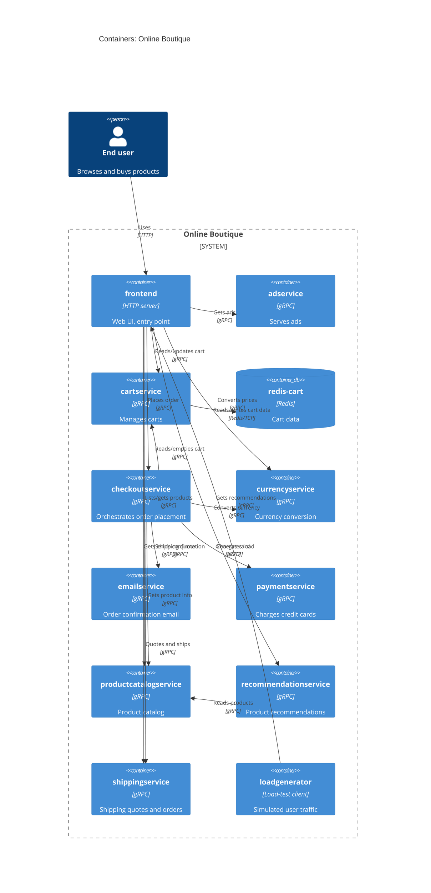

# Task 1, Run B: Recovered architecture (C4 container level)

## 1. Agent

Claude Sonnet 5.5 (claude-sonnet-5-5) via Claude Code subagent.

## 2. Files read

Task and rules:
- `AGENTS.md`
- `CLAUDE.md` (auto-attached by the harness; it only points to AGENTS.md)
- `prompts/1-recover-architecture.md`

Evidence:
- `system/online-boutique/protos/demo.proto`
- `system/online-boutique/kubernetes-manifests/README.md`
- `system/online-boutique/kubernetes-manifests/adservice.yaml`
- `system/online-boutique/kubernetes-manifests/cartservice.yaml`
- `system/online-boutique/kubernetes-manifests/checkoutservice.yaml`
- `system/online-boutique/kubernetes-manifests/currencyservice.yaml`
- `system/online-boutique/kubernetes-manifests/emailservice.yaml`
- `system/online-boutique/kubernetes-manifests/frontend.yaml`
- `system/online-boutique/kubernetes-manifests/kustomization.yaml`
- `system/online-boutique/kubernetes-manifests/loadgenerator.yaml`
- `system/online-boutique/kubernetes-manifests/paymentservice.yaml`
- `system/online-boutique/kubernetes-manifests/productcatalogservice.yaml`
- `system/online-boutique/kubernetes-manifests/recommendationservice.yaml`
- `system/online-boutique/kubernetes-manifests/shippingservice.yaml`

## 3. Containers table

Implementation languages are not shown by any evidence file (images are only named `image: <service>`), so the technology column states what is evidenced.

| Container | Technology / language | Responsibility | Evidence |
|---|---|---|---|
| frontend | HTTP server on 8080; language Not evidenced in the provided files | Web UI entry point; exposed externally via a LoadBalancer Service; calls backend services over gRPC | `kubernetes-manifests/frontend.yaml` (Deployment `frontend`, Service `frontend-external` type LoadBalancer, readiness `httpGet /_healthz`) |
| adservice | gRPC (port 9555); language Not evidenced | Returns text ads for given context keywords | `protos/demo.proto` (`service AdService`, `GetAds`); `kubernetes-manifests/adservice.yaml` (grpc probe, port 9555) |
| cartservice | gRPC (port 7070); language Not evidenced | Stores and retrieves a user's cart (AddItem, GetCart, EmptyCart) | `protos/demo.proto` (`service CartService`); `kubernetes-manifests/cartservice.yaml` (port 7070) |
| redis-cart | Redis (`image: redis:alpine`, port 6379), data in an `emptyDir` volume | Data store for cart data | `kubernetes-manifests/cartservice.yaml` (Deployment `redis-cart`, `volumes: redis-data emptyDir`) |
| checkoutservice | gRPC (port 5050); language Not evidenced | Orchestrates `PlaceOrder`: cart, catalog, currency, shipping, payment, email | `protos/demo.proto` (`service CheckoutService`); `kubernetes-manifests/checkoutservice.yaml` (env `*_SERVICE_ADDR`) |
| currencyservice | gRPC (port 7000); language Not evidenced | Lists supported currencies and converts Money | `protos/demo.proto` (`service CurrencyService`); `kubernetes-manifests/currencyservice.yaml` |
| emailservice | gRPC (container port 8080, Service port 5000); language Not evidenced | Sends order confirmation emails | `protos/demo.proto` (`service EmailService`, `SendOrderConfirmation`); `kubernetes-manifests/emailservice.yaml` (port 5000 -> targetPort 8080) |
| paymentservice | gRPC (port 50051); language Not evidenced | Charges a credit card, returns a transaction id | `protos/demo.proto` (`service PaymentService`, `Charge`); `kubernetes-manifests/paymentservice.yaml` |
| productcatalogservice | gRPC (port 3550); language Not evidenced | Lists, gets and searches products | `protos/demo.proto` (`service ProductCatalogService`); `kubernetes-manifests/productcatalogservice.yaml` |
| recommendationservice | gRPC (port 8080); language Not evidenced | Recommends products (uses the catalog) | `protos/demo.proto` (`service RecommendationService`); `kubernetes-manifests/recommendationservice.yaml` (env `PRODUCT_CATALOG_SERVICE_ADDR`) |
| shippingservice | gRPC (port 50051); language Not evidenced | Quotes shipping cost and ships orders | `protos/demo.proto` (`service ShippingService`); `kubernetes-manifests/shippingservice.yaml` |
| loadgenerator | Load-test client; tool Not evidenced | Generates simulated user traffic against the frontend (test tooling, not a business container; excluded by `kustomization.yaml`) | `kubernetes-manifests/loadgenerator.yaml` (env `FRONTEND_ADDR`, `USERS`, `RATE`); `kustomization.yaml` (commented-out entry) |

## 4. Dependencies table

All gRPC claims combine the address env var (manifest) with the matching `service` in `protos/demo.proto`; ports match each target's Service/containerPort.

| Caller -> Callee | Protocol | Evidence |
|---|---|---|
| End user -> frontend | HTTP | `frontend.yaml` (Service `frontend-external`, type LoadBalancer, port 80 -> 8080) |
| loadgenerator -> frontend | HTTP | `loadgenerator.yaml` (env `FRONTEND_ADDR: frontend:80`; init container `wget http://${FRONTEND_ADDR}`) |
| frontend -> productcatalogservice | gRPC | `frontend.yaml` (`PRODUCT_CATALOG_SERVICE_ADDR: productcatalogservice:3550`) |
| frontend -> currencyservice | gRPC | `frontend.yaml` (`CURRENCY_SERVICE_ADDR: currencyservice:7000`) |
| frontend -> cartservice | gRPC | `frontend.yaml` (`CART_SERVICE_ADDR: cartservice:7070`) |
| frontend -> recommendationservice | gRPC | `frontend.yaml` (`RECOMMENDATION_SERVICE_ADDR: recommendationservice:8080`) |
| frontend -> shippingservice | gRPC | `frontend.yaml` (`SHIPPING_SERVICE_ADDR: shippingservice:50051`) |
| frontend -> checkoutservice | gRPC | `frontend.yaml` (`CHECKOUT_SERVICE_ADDR: checkoutservice:5050`) |
| frontend -> adservice | gRPC | `frontend.yaml` (`AD_SERVICE_ADDR: adservice:9555`) |
| checkoutservice -> productcatalogservice | gRPC | `checkoutservice.yaml` (`PRODUCT_CATALOG_SERVICE_ADDR: productcatalogservice:3550`) |
| checkoutservice -> shippingservice | gRPC | `checkoutservice.yaml` (`SHIPPING_SERVICE_ADDR: shippingservice:50051`) |
| checkoutservice -> paymentservice | gRPC | `checkoutservice.yaml` (`PAYMENT_SERVICE_ADDR: paymentservice:50051`) |
| checkoutservice -> emailservice | gRPC | `checkoutservice.yaml` (`EMAIL_SERVICE_ADDR: emailservice:5000`; Service port 5000 in `emailservice.yaml`) |
| checkoutservice -> currencyservice | gRPC | `checkoutservice.yaml` (`CURRENCY_SERVICE_ADDR: currencyservice:7000`) |
| checkoutservice -> cartservice | gRPC | `checkoutservice.yaml` (`CART_SERVICE_ADDR: cartservice:7070`) |
| recommendationservice -> productcatalogservice | gRPC | `recommendationservice.yaml` (`PRODUCT_CATALOG_SERVICE_ADDR: productcatalogservice:3550`) |
| cartservice -> redis-cart | Redis (over TCP) | `cartservice.yaml` (`REDIS_ADDR: redis-cart:6379`; Service `redis-cart` port name `tcp-redis`) |

## 5. Mermaid diagram

## 6. Gaps

| Gap | What is missing | Extra file that would settle it |
|---|---|---|
| Implementation languages / frameworks | Manifests only say `image: <name>`; the proto is language-neutral (only `go_package` option) | Each service's source folder or Dockerfile under `system/online-boutique/src/` |
| `shoppingassistantservice` | `frontend.yaml` sets `SHOPPING_ASSISTANT_SERVICE_ADDR: shoppingassistantservice:80`, but no manifest, proto service or Deployment for it exists in the evidence; it may be optional (kustomize component `shopping-assistant` is commented out). Not drawn. | `kustomize/components/shopping-assistant/` and frontend source |
| Frontend -> shoppingassistantservice protocol | Port 80 suggests HTTP but this is not proven | Frontend source (handler for the assistant) |
| Frontend calls to paymentservice / emailservice | No env var in `frontend.yaml`; not shown | Frontend source (confirms no direct calls) |
| Outbound calls of adservice, currencyservice, paymentservice, shippingservice, emailservice, productcatalogservice | No `*_ADDR` env vars, so no outgoing dependencies are evidenced | Each service's source code |
| Productcatalog data source | No env var or volume shows where products are stored (could be a file, DB, or other) | `src/productcatalogservice/` source (and `kustomize/components/` alternatives) |
| External systems | No external system (real payment gateway, SMTP provider, etc.) appears in the evidence, so none is drawn | Source of paymentservice and emailservice |
| `kustomization.yaml` optional components (memorystore, alloydb, spanner, google-cloud-operations, network-policies) | Commented out; they may replace redis-cart or add data stores/external systems in other deployments | `kustomize/components/*` |
| Which manifest set is actually deployed | `kubernetes-manifests/README.md` says these are not directly deployable (images injected by skaffold; `/release` manifests are used) | `/release/*.yaml`, `skaffold.yaml` |
| Persistence of redis-cart | `emptyDir` implies data is lost when the pod restarts; whether another store is used in production is not shown | `/release` manifests, `kustomize/components/memorystore` |
| loadgenerator tool | Container type is only inferred from its name and env vars (`USERS`, `RATE`) | `src/loadgenerator/` |
